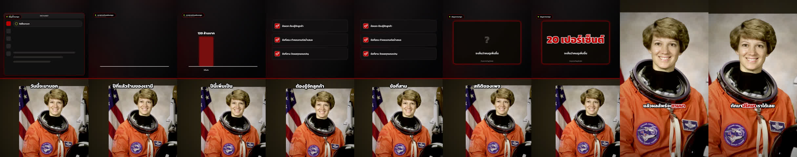
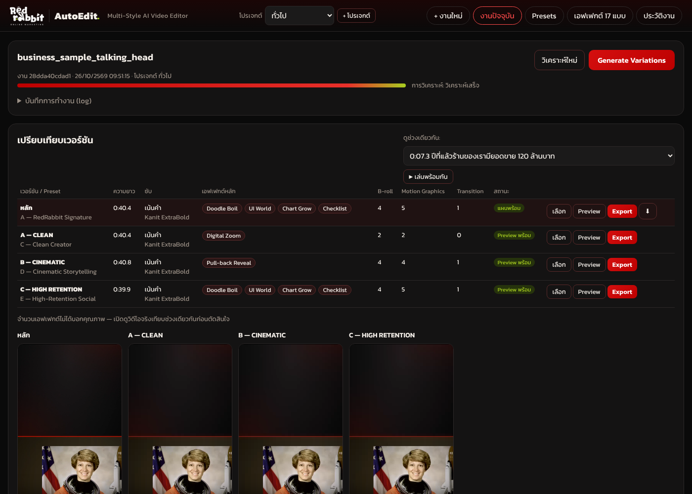
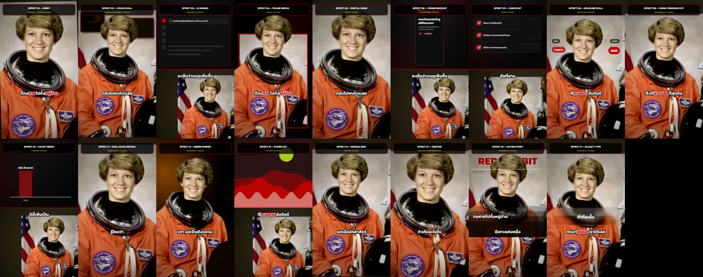

# AutoEdit — Multi-Style AI Video Editor (วิดีโอแนวตั้ง)

อัปโหลดคลิปผู้พูดหน้ากล้อง → ระบบถอดเสียง วิเคราะห์เนื้อหา ตัดช่วงเงียบ/คำติดปาก/ประโยคพูดซ้ำ จัดภาพ 9:16 ตามใบหน้า
→ **AI Director เลือกเอฟเฟกต์จาก Effect Library 17 แบบตามเนื้อหา** (ไม่ใช้ชุดเดิมกับทุกคลิป) → แสดง
**Editing Timeline & Effect Map ให้แก้ไขได้** → Preview → Export MP4 1080×1920 (H.264/AAC) พร้อมซับและกราฟิก → QC อัตโนมัติ
สร้างได้หลายเวอร์ชันจากไฟล์เดียว (Clean / Cinematic / High Retention / Creative / Auto Director) และเปรียบเทียบในหน้าเดียว





## เริ่มใช้งาน

```bash
# 1) FFmpeg (ต้องมี libass + libx264) และ Python 3.10+
sudo apt install ffmpeg libegl1 libgles2      # libegl/libgles: ให้ MediaPipe (แยกตัวบุคคล) ทำงานบน Linux
# 2) แพ็กเกจ Python
pip install -r requirements.txt
# 3) เปิดเว็บแอป
./run.sh                                      # แล้วเปิด http://localhost:8000
```

- ใช้ OpenCV **4.x แบบ contrib ตัวเดียว** (`requirements.txt` ปักไว้แล้ว) — OpenCV 5 ไม่มีตัวตรวจใบหน้า Haar และ MediaPipe จะดึง OpenCV มาเองถ้าไม่ปักเวอร์ชัน
- ครั้งแรกที่ถอดเสียง `faster-whisper` จะดาวน์โหลดโมเดลจาก huggingface.co (small ≈ 500 MB) — ออกเน็ตไม่ได้ให้แนบ `.srt`/`.vtt`
- โมเดลแยกตัวบุคคล MediaPipe (`assets/models/selfie_multiclass_256x256.tflite`) มาพร้อมโปรเจกต์ ถ้าไม่มี MediaPipe
  เอฟเฟกต์ที่ต้องตัดขอบตัวบุคคลจะใช้ Fallback ให้อัตโนมัติ (ดูตารางด้านล่าง)

## ใช้งานบนหน้าเว็บ

| ส่วน | ทำอะไร |
|---|---|
| **โปรเจกต์** (มุมบน) | แยกความจำสไตล์ต่อลูกค้า/โปรเจกต์: Preset ล่าสุด, Density, Intensity, ซับ, Export profile, สีแบรนด์ — เปิดครั้งหน้าค่าเดิมกลับมาเอง และไม่ปะปนข้ามโปรเจกต์ |
| **งานใหม่** | อัปโหลดวิดีโอ (+ Transcript, ภาพอ้างอิง, B-roll, เพลง) → เลือก **Style Preset** → **โหมด A–F**, **Density 1–4**, **Intensity LOW/MEDIUM/HIGH**, ฟอนต์/รูปแบบซับ, Export profile ฯลฯ → "เริ่มตัดต่ออัตโนมัติ" · "บันทึกค่านี้เป็น Preset ใหม่" ได้ทันที |
| **งานปัจจุบัน** | สถานะการวิเคราะห์ · ตารางเปรียบเทียบเวอร์ชัน · แท็บแต่ละเวอร์ชัน (เปลี่ยน Preset/โหมด/Density ได้โดย **ไม่ต้องวิเคราะห์ใหม่**) · AI Director summary · Preflight (เวลาโดยประมาณ, พื้นที่ดิสก์, API) · Preview/Export/ยกเลิก · QC · สถานะการเรนเดอร์ของแต่ละเอฟเฟกต์ |
| **Editing Timeline & Effect Map** | ทุกประโยค: Start/End, บทพูด (แก้ได้), คำเน้น, รูปแบบภาพ (Layout/ระดับภาพ/กราฟิกพื้นฐาน/Title), **เอฟเฟกต์ที่เลือก + เหตุผล + พารามิเตอร์** (ลบ/เพิ่ม/ปรับได้), **Transition เข้า**, เสียงประกอบ, งบเอฟเฟกต์ (Effect Budget) ของช่วงนั้น |
| **Generate Variations** | เลือก A CLEAN · B CINEMATIC · C HIGH RETENTION · D CREATIVE · E AUTO DIRECTOR → ระบบสร้าง Plan แยกต่อเวอร์ชันจากผลวิเคราะห์เดียวกัน และเข้าคิว Preview ทีละเวอร์ชัน (แสดงสถานะแยก) |
| **เปรียบเทียบเวอร์ชัน** | ชื่อ/Preset, ความยาว, ซับ, เอฟเฟกต์หลัก, จำนวนช่วง B-roll / Motion Graphics / Transition, สถานะ, ปุ่ม เลือก/Preview/Export/ดาวน์โหลด และ "ดูช่วงเดียวกัน" — เลื่อนทุกวิดีโอไปที่ประโยคเดียวกัน (คำนวณจาก Timeline ของแต่ละเวอร์ชัน) แล้วเล่นพร้อมกัน |
| **Presets** | 7 Preset ในตัว (อ่านอย่างเดียว) + สร้าง/แก้ไข/ทำสำเนา/เปลี่ยนชื่อ/ลบ Custom Preset — เก็บใน `data/presets.json` ตรวจข้อมูลด้วย schema และอ่านกลับจากไฟล์ก่อนแจ้งว่าบันทึกสำเร็จ |
| **เอฟเฟกต์ 17 แบบ** | รายงานสถานะจริงของทุกเอฟเฟกต์ในเครื่องนี้ (ทำงานจริง/จำลอง/ต้องใช้ API, Input, Fallback, สิ่งที่ต้องการ) |

### Command line

```bash
python3 cli.py --list-presets
python3 cli.py clip.mp4 --preset redrabbit_signature -o out.mp4
python3 cli.py clip.mp4 --srt clip.srt --mode mograph --density 3 --intensity high --preview
python3 cli.py clip.mp4 --srt clip.srt --variations clean,cinematic,retention,creative,auto --preview
python3 tools/effect_gallery.py samples/sample_talking_head.mp4 samples/sample.srt gallery.mp4   # เรนเดอร์ครบ 17 เอฟเฟกต์
```

## Effect Library — อะไรทำงานจริง อะไรจำลอง อะไรต้องใช้ API

ทุกเอฟเฟกต์เป็นโมดูลแยก (`engine/effects/`) มี Effect ID, ชื่อ, พารามิเตอร์ (ตามระดับ Intensity), เงื่อนไขใช้งาน (`eligible`),
Input, ฟังก์ชันเรนเดอร์ (camera / composite / panel / post / overlay), Fallback และรายงานสถานะการเรนเดอร์ไปที่ QC
ทั้ง 17 ตัวผ่านการเรนเดอร์จริงบนฟุตเทจทดสอบด้วย `tools/effect_gallery.py` (ผลอยู่ที่ `samples/effects_gallery.mp4`)



| # | เอฟเฟกต์ | ระดับ | สิ่งที่เรนเดอร์จริง | Fallback / สิ่งที่ต้องมีเพิ่มเพื่อเวอร์ชันเต็ม |
|---|---|---|---|---|
| 01 | Orbit | **จำลอง** | หมุนภาพเล็กน้อย + เลื่อนแนวนอน + ดันเข้า แบบ rigid (ไม่บิดใบหน้า) | Orbit จริงต้องมีฟุตเทจหลายมุมหรือ API novel-view synthesis (ยังไม่ได้เชื่อม) |
| 02 | Couch Wall | ทำงานจริง | ใช้ฉากจริงของผู้พูด วางกรอบภาพประกอบ/คำสำคัญบนผนัง **หลัง** ตัวบุคคลด้วย mask | ไม่มี mask → กรอบอยู่ด้านหน้า · การสร้างฉากโซฟาใหม่ต้องใช้ AI image API |
| 03 | UI World | ทำงานจริง | Dashboard: แถบค้นหาพิมพ์ตามเสียง, การ์ด KPI เฉพาะตัวเลขที่พูดจริง | ไม่มีตัวเลข → ใช้คำสำคัญ |
| 04 | Frame Break | ทำงานจริง | MediaPipe แยกตัวบุคคล → พื้นหลัง → การ์ด+เงา+กรอบสีแบรนด์ → ตัวบุคคลล้ำออกนอกกรอบ | mask ไม่ผ่าน QC → กรอบซ้อน (ไม่ทะลุ) |
| 05 | Digital Zoom | ทำงานจริง | ซูมเข้า/ออก/Micro/Pulse ต่อเฟรม จำกัดตามความละเอียดต้นฉบับ | ลดระดับซูมอัตโนมัติถ้าขยายเกิน 2.3× |
| 06 | Phone Mockup | ทำงานจริง | กรอบมือถือ + เงา + ลอย แสดงภาพ/วิดีโอที่อัปโหลด | ไม่มีไฟล์ → หน้าจอจำลองจากคำพูด พร้อมป้าย "ภาพจำลองหน้าจอ" |
| 07 | Checklist | ทำงานจริง | รายการจากบทพูด ติ๊กถูกเมื่อพูดถึง แบ่งหน้าเมื่อเกินจำนวน | — |
| 08 | Headline Wall | ทำงานจริง | คำสำคัญ/ตัวเลขลอยรอบผู้พูด ขนาดตามความสำคัญ หลบหน้าและซับ | ลดจำนวนถ้าพื้นที่ไม่พอ |
| 09 | Zoom-through Cut | ทำงานจริง (2D) | ซูมเข้าจุดโฟกัส → ฉากใหม่ซูมออกจากจุดเดียวกัน + วงแหวนสีแบรนด์ + แฟลช | ไม่สร้างภาพ 3 มิติ |
| 10 | Chart Grow | ทำงานจริง | กราฟแท่งจากตัวเลข ≥2 ค่า หน่วยเดียวกันในบทพูด พร้อมหน่วย ช่วงเวลา ที่มา | ข้อมูลไม่พอ → การ์ดตัวเลขเดี่ยว (ไม่แต่งตัวเลข) · QC ตรวจว่าค่ามีในบทพูด |
| 11 | Pull-back Reveal | ทำงานจริง (2D) | เริ่มใกล้แล้วสเกลออกด้วย easing ต้นประโยค | ลดซูมเริ่มต้นถ้าความละเอียดไม่พอ |
| 12 | Green Screen | ทำงานจริง | ฉากเขียว/น้ำเงิน → Chroma key + despill; ฉากปกติ → Background removal ด้วย mask, วางบนภาพประกอบ/ฉากแบรนด์ + เงาสัมผัส | แยกไม่ได้ → คงพื้นหลังเดิม |
| 13 | Paper Cut | ทำงานจริง (procedural) | ชั้นกระดาษจากภาพที่อัปโหลดหรือฉากจากคำสำคัญ + เงา + เท็กซ์เจอร์ + Stop motion 8 fps | ภาพประกอบใหม่ด้วย AI ต้องตั้ง `AUTOEDIT_IMAGE_CMD` |
| 14 | Doodle Boil | ทำงานจริง | วงกลม/ขีดเส้นใต้/ลูกศรวาดมือรอบคำที่เน้นในซับ วาดใหม่ทุก 1/12 วินาที | — |
| 15 | Vertigo | **จำลอง** (2.5D) | ตัวแบบคงขนาด ฉากหลังหดถอยออก (ใช้ mask) | Dolly zoom จริงต้องมีข้อมูลความลึก/ฟุตเทจ · ไม่มี mask → scale + rotation เบาๆ |
| 16 | Cover Story | ทำงานจริง | ชื่อแบรนด์เป็นหัวนิตยสาร **หลังศีรษะ** (mask), ฉบับ/วันที่จริง, พาดหัวจากบทพูด, cover lines = ประเด็นถัดไปในคลิป | ไม่มี mask → หัวนิตยสารอยู่ด้านหน้า |
| 17 | Glassy Type | ทำงานจริง | เบลอภาพจริงด้านหลังเฉพาะพื้นที่ + ฟิล์มโปร่งแสง + ขอบสะท้อน + เรืองสีแบรนด์ | — |

**ต้องใช้ API ภายนอก (ไม่ได้เปิดใช้โดยอัตโนมัติ):** การวิเคราะห์เรื่องด้วย Claude (`ANTHROPIC_API_KEY` + ผู้ใช้ติ๊กอนุญาต),
การสร้างภาพประกอบ AI (`AUTOEDIT_IMAGE_CMD` + ผู้ใช้ติ๊กอนุญาต) ระบบจะไม่เรียก API ที่อาจมีค่าใช้จ่ายโดยไม่ได้รับอนุญาต
และแสดงสถานะใน Preflight; ไม่มีเอฟเฟกต์ใดใน 17 แบบที่ "ใช้ไม่ได้เลย" เมื่อไม่มี API — ทุกตัวมีทางเลือกที่ระบบทำได้เอง

## AI Director (Auto Effect Selection)

`engine/effects/selector.py`
1. **ตรวจประเภทคลิป** จากบทพูดทั้งหมด: สอน/How-to · เล่าเรื่อง · รีวิว · ข่าว/ข้อมูล · โปรโมต · ตื่นเต้น · พูดหน้ากล้อง
2. **ให้คะแนนแต่ละช่วง**: ความสำคัญ (บทบาท Hook/จุดเปลี่ยน/สรุป, ตัวเลข, คำเน้น), การเปลี่ยนหัวข้อ, ความซับซ้อนของข้อมูล, ความเร็วพูด
3. **Effect Budget ต่อช่วง** ตามระดับ Density: MINIMAL (กราฟิกเฉพาะจุดสำคัญ ไม่มี Transition) · BALANCED (แนะนำ) · DYNAMIC · EXPERIMENTAL
   — ช่วงที่มี Title/กราฟิกอยู่แล้วจะไม่ได้ Zoom + Transition + SFX ซ้อนครบทุกอย่าง, B-roll พื้นฐานก็นับเป็น Motion Graphics
4. **เลือกเอฟเฟกต์** จากน้ำหนักของโหมด (A Clean · B Story · C Retention · D MoGraph · E Experimental · F Auto = ตามประเภทคลิป)
   คูณความเหมาะสมของเนื้อหา, ลดคะแนนเอฟเฟกต์ที่เพิ่งใช้ (ไม่ใช้ซ้ำติดกัน), จำกัดจำนวนครั้งต่อคลิป, จำกัดวินาทีของงานหนัก (แยกตัวบุคคล)
5. **Intensity** ปรับพารามิเตอร์ของแต่ละเอฟเฟกต์ (ระยะซูม มุมหมุน จำนวนพาดหัว ฯลฯ) — HIGH = เด่นชัดขึ้นในช่วงที่ถูกเลือก ไม่ใช่ใส่ทุกวินาที
6. ทุกการตัดสินใจมี **เหตุผลภาษาไทย** แสดงใน Effect Map และสรุปใน AI Director summary

## Presets ในตัว

| Preset | โหมด | Density | จุดเด่น |
|---|---|---|---|
| A — RedRabbit Signature | High-Retention | BALANCED | ดำ/ขาว/แดง `#BC0000` + เขียวมะนาว, ซับเน้นคำ, Punch-in/Jump cut |
| B — Dark Gold Story | Storytelling | BALANCED | ดำ–ส้มทอง, Headline Wall, Phone Mockup, Pull-back, Digital Zoom |
| C — Clean Creator | Clean | MINIMAL | ผู้พูดเป็นหลัก, Cut อย่างเดียว, ไม่มี SFX/Title |
| D — Cinematic Storytelling | Storytelling | BALANCED | Pull-back, Orbit, Paper cut, Vertigo, จังหวะช้า |
| E — High-Retention Social | Retention | DYNAMIC | Hook ชัด ตัดเร็ว Zoom-through เฉพาะจุดเปลี่ยน |
| F — Motion Graphics Pro | MoGraph | DYNAMIC | UI World, Chart Grow, Checklist, Glassy Type |
| G — Creative Experimental | Experimental | EXPERIMENTAL | ผสมได้ทั้ง 17 แบบเมื่อเหมาะสม |

Custom Preset ตั้งค่าได้: ชื่อ, สีหลัก/รอง (หรือใช้สีแบรนด์ของโปรเจกต์), ฟอนต์ซับ (Kanit / Prompt / Chakra Petch / Mitr — SIL OFL),
รูปแบบ/ขนาดซับ, โหมด, Density, Intensity, จังหวะ, เอฟเฟกต์ที่อนุญาต/ห้ามใช้, Transition, SFX/เพลง, Aspect ratio, Export profile
(1080p คุณภาพสูง · 1080p เร็ว · 720p)

## ประสิทธิภาพและทรัพยากร

- **Preflight** ก่อน Export: ประมาณเวลา (ปรับเทียบจากเวลาเรนเดอร์จริงของเครื่องนี้ใน `data/perf.json`), พื้นที่ดิสก์, วินาทีที่ต้องแยกตัวบุคคล,
  API ภายนอกที่จะ/ไม่ถูกเรียก, เอฟเฟกต์ที่จะใช้ Fallback
- **Cache**: คลิป, mask ตัวบุคคล และภาพที่สร้างขึ้น เก็บตาม hash ของเนื้อหาใน `data/jobs/<id>/cache/` — ใช้ร่วมกันข้ามเวอร์ชัน
  เรนเดอร์ซ้ำ/เปลี่ยนเล็กน้อยจะทำเฉพาะคลิปที่เปลี่ยน
- **ยกเลิก/ทำต่อ**: ปุ่มยกเลิกหยุดระหว่างคลิป; กดเรนเดอร์ใหม่จะใช้คลิปที่เสร็จแล้วจาก cache
- งานประมวลผลทีละงาน (คิวเดียว) แต่ละเวอร์ชันมีสถานะแยก; สถานะการสร้างภาพ AI แยกจากการเรนเดอร์ใน log

## QC ก่อนส่งงาน (`engine/qc.py`)

เปิดเล่น/ถอดรหัสได้ทั้งไฟล์ · ความละเอียด/codec/ความยาว · H.264 profile/level, yuv420p, faststart · จำนวนเฟรม/เฟรมเรตคงที่ ·
เสียง 48 kHz สเตอริโอ, ความดัง (LUFS), True peak · เฟรมดำ (รวมที่จุด Transition) · ซับตรงช่วงเสียงพูด · จุดตัดไม่อยู่กลางคำ ·
กราฟิกล้นเฟรม/นอก Safe Zone/ทับใบหน้า · ซับเล็กเกินอ่าน · ค่าในกราฟตรงกับบทพูด · คุณภาพ mask ตัวบุคคล · เอฟเฟกต์ที่ใช้ Fallback/ล้มเหลว
ข้อผิดพลาดที่แก้เองได้ (เอฟเฟกต์ล้มเหลว, เสียงพีค, ตัดกลางคำ) → ลดความซับซ้อน/แก้แผนแล้วเรนเดอร์ใหม่อัตโนมัติ 1 รอบ

## ข้อจำกัดที่ควรทราบ

- รองรับ Aspect ratio **9:16 เท่านั้น** (Preset จะปฏิเสธค่าอื่นพร้อมเหตุผล) — เลย์เอาต์ทั้งหมดออกแบบสำหรับแนวตั้ง
- Orbit และ Vertigo เป็นการจำลอง 2D/2.5D ไม่ใช่การเคลื่อนกล้อง 3 มิติจริง
- คุณภาพการแยกตัวบุคคลขึ้นกับฟุตเทจ (ผมฟู/แสงย้อน/พื้นหลังสีใกล้ผิว) — ระบบวัดคุณภาพ mask ทุกคลิปและสลับไปใช้ Fallback เอง
- การตรวจคำสะกดแจ้งเตือนเท่านั้น (ชื่อเฉพาะมักไม่อยู่ในพจนานุกรม) — เพิ่มคำของคุณได้ที่ `data/custom_words.txt` (บรรทัดละคำ)
- ไม่มีการค้นหา Stock footage/ภาพบุคคลออนไลน์ — อัปโหลดไฟล์ที่มีสิทธิ์ใช้งานเอง

## โครงสร้างโปรเจกต์

```
app.py                 เว็บเซิร์ฟเวอร์ + API      cli.py   ใช้งานผ่าน command line
static/                หน้าเว็บ
engine/
  pipeline.py          วิเคราะห์ (ครั้งเดียว) → plan ต่อเวอร์ชัน → render → QC, preflight
  jobs.py              งาน, เวอร์ชัน (variants), คิว, ยกเลิก
  presets.py           Preset ในตัว + Custom (JSON + schema)    projects.py  ความจำต่อโปรเจกต์
  effects/             base.py · camera.py · compositing.py · panels.py · overlays.py · selector.py (AI Director)
                       segmentation.py (MediaPipe) · assets_gen.py (กรอบมือถือ/กระดาษตัด)
  render.py            Reframe, layout, ชั้นเอฟเฟกต์, cache, ซับ/กราฟิก, มิกซ์เสียง, Export profiles
  graphics.py          Motion graphics + ซับ (ASS/libass)   qc.py  ตรวจคุณภาพ
  transcribe.py thai.py analyze.py vision.py planner.py llm.py media.py env.py
assets/fonts (OFL)  assets/models (Haar, MediaPipe)  assets/brand (โลโก้)
samples/            คลิปทดสอบ (เล่าเรื่อง + ธุรกิจ) และผลลัพธ์ตัวอย่าง
tests/              test_engine.py (pytest) · acceptance_ui.js (Acceptance tests 1–7 ผ่านเบราว์เซอร์)
docs/               ภาพหน้าจอ · acceptance_results.json
```

## ไฟล์ตัวอย่าง

| ไฟล์ | คืออะไร |
|---|---|
| `samples/output_demo.mp4` | เวอร์ชันหลัก (RedRabbit Signature) 1080×1920 จาก Acceptance TEST 1 |
| `samples/variations/` | A Clean / B Cinematic (Preview) และ C High Retention (Final) จากต้นฉบับเดียวกัน (TEST 4–5) |
| `samples/effects_gallery.mp4` | ทั้ง 17 เอฟเฟกต์ 1080×1920 พร้อมป้ายชื่อและระดับการทำงาน |
| `docs/acceptance_results.json` | ผล Acceptance tests 1–7 ล่าสุด |

## การทดสอบ

```bash
python3 -m pytest tests -q                         # unit tests
node tests/acceptance_ui.js                        # Acceptance tests 1–7 (เปิด/ปิด/รีสตาร์ทเซิร์ฟเวอร์เอง) → docs/acceptance_results.json
python3 tools/effect_gallery.py samples/sample_talking_head.mp4 samples/sample.srt samples/effects_gallery.mp4
```

คลิปทดสอบสร้างจากภาพ public domain (NASA ผ่าน scikit-image) + เสียงสังเคราะห์ภาษาไทย (espeak-ng) ด้วย `tools/make_sample.py`
— ภาพเป็นภาพนิ่งที่ขยับเล็กน้อย จึงควรทดสอบกับฟุตเทจจริงของคุณเพิ่มเติม
